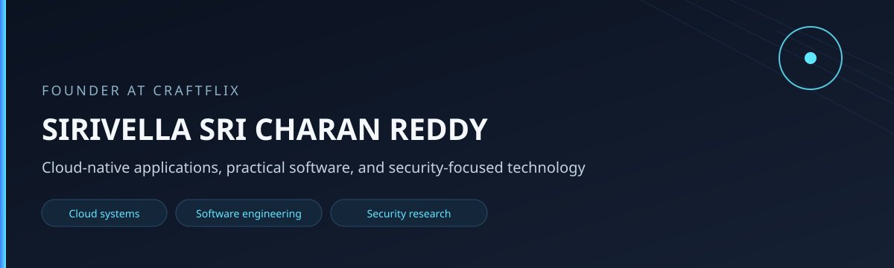
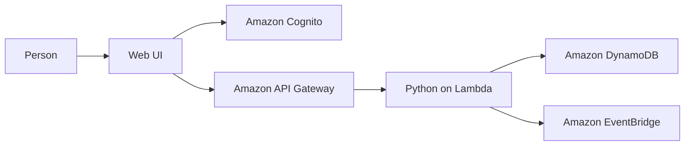

<p align="center">
  
</p>

# SIRIVELLA SRI CHARAN REDDY

**Founder of Craftflux. Aspiring cloud and software engineer.**

<p>
  
  
  
  
</p>

I am the founder of Craftflux, and I am building toward cloud and software engineering. The public systems I can point to are ERA, the Emergency Resource Allocation Platform, an Azure traffic dashboard, and a Python task API inside a portfolio repository. 
## Building Craftflux

**Company building digital products and technology solutions.**

| | |
| --- | --- |
| Role | Founder |
| Company | Craftflux |
| Description | Company building digital products and technology solutions. |
| Website | www.craftflux.co.in |

The engineering linked below belongs to those repositories. It is not a published company site, product list, or launch.

## About

I study and build cloud-native applications in public repositories. ERA / ERAP is the largest of those codebases. The traffic dashboard is a college project with a hosted demo. The task API is local code plus a SAM template inside another repository. Deployment of ERA is not authorized, and that project is not production-ready.

## Technical Skills

Each line is tied to a repository. "Implemented" means the code or workflow is in that repository. It does not mean a live production system.

### Cloud Platforms

| Item | Level | Where |
| --- | --- | --- |
| AWS | Implemented in repository code | [ERA / ERAP](#era-and-erap) and the [task API](#serverless-task-api). ERA deployment is not authorized. The task API's recorded stack was not re-checked |
| Azure | Implemented in one project | [Smart Traffic](#smart-traffic-monitoring-and-analytics-dashboard): Functions, Cosmos DB, and a Storage static website |

### AWS and Serverless

| Item | Level | Where |
| --- | --- | --- |
| Lambda | Implemented in repository code | 16 function names in the ERA manifest. One function in the task API template |
| API Gateway | Described and templated | ERA architecture docs. SAM template for the task API. No live hostname is listed |
| DynamoDB | Implemented in repository code | 14 ERA tables in the manifest. Task API repository class and a `Tasks` table in the template |
| EventBridge | Implemented in the current ERA path | Allocation and release publish events |
| Cognito | Implemented in the ERA frontend | Sign-in, signup, refresh, logout, optional authenticator setup |
| IAM | Documented | ERA permission notes. Portfolio notes say the ERA deploy workflow uses GitHub OIDC. Not a finished review |
| AWS SAM | Local template | Task API. The template is not treated here as a live stack |
| CloudWatch | Named in ERA architecture docs | Not re-checked as a live configuration |
| S3 and SNS | Earlier ERA README only | Not current dependencies under `src/` |

### Azure

| Item | Level | Where |
| --- | --- | --- |
| Azure Functions | Implemented in the traffic repo | HTTP routes for traffic, analytics, prediction, simulate, and health |
| Cosmos DB | Implemented when configured | Traffic readings. Empty settings use a local JSON file instead |
| Storage static website | Hosted demo | Public site linked below. HTTP 200 means the host responded, not that every feature was exercised |
| Container Apps | Partial demo | `azure-container-demo` is one HTML page, an nginx Dockerfile, and a workflow. No live URL was verified |
| Static Web Apps | Not used | The traffic README says the student subscription's regions did not allow it |

### Programming and Development

| Item | Level | Where |
| --- | --- | --- |
| Python | Implemented | ERA, the task API, and the traffic API |
| JavaScript | Implemented in the static UI | ERA `frontend/app.js` and related scripts. Not an expertise claim |
| HTML | Implemented in the static UI | ERA `frontend/index.html`. Not an expertise claim |
| CSS | Implemented in the static UI | ERA `frontend/style.css` and `frontend/design-system.css`. Not an expertise claim |
| React and Vite | Implemented | Traffic dashboard |
| Git and GitHub | Implemented | These public repositories |

### Architecture and Engineering

| Item | Level | Where |
| --- | --- | --- |
| Handler, service, repository split | Implemented in local code | Task API. Tests use memory, not AWS |
| Pytest modules | Present, not rerun | 91 ERA test modules. No pass count is claimed |
| Unittest and frontend build | Present in the traffic workflow | This profile did not rerun them |
| GitHub Actions | Implemented as workflows | ERA CI does not deploy. Traffic deploy jobs are gated |
| Docs and workflow checks | Implemented in the repos | ERA CI also compiles Python, checks packages, and scans for secrets |


## Featured projects

| Project | Where |
| --- | --- |
| [ERA / ERAP](#era-and-erap) | [emergency-resource-allocation](https://github.com/sricharanreddy5414/emergency-resource-allocation) |
| [Smart Traffic](#smart-traffic-monitoring-and-analytics-dashboard) | [Repository](https://github.com/sricharanreddy5414/smart-traffic-monitoring-analytics-dashboard) and [hosted demo](https://stsmarttrafficweb5414.z29.web.core.windows.net/) |
| [Serverless Task API](#serverless-task-api) | [freelancing-aws-portfolio](https://github.com/sricharanreddy5414/freelancing-aws-portfolio), `Portfolio/Serverless-API` |

## ERA and ERAP

**Emergency Resource Allocation Platform.** ERA and ERAP are one project.

| | |
| --- | --- |
| Repository | [sricharanreddy5414/emergency-resource-allocation](https://github.com/sricharanreddy5414/emergency-resource-allocation) |
| Also described in | [freelancing-aws-portfolio](https://github.com/sricharanreddy5414/freelancing-aws-portfolio), which does not copy this source |
| Data | Fictional or test data. The project README says it is not a medical system, an emergency-dispatch system, or a medical decision-making system |
| Allocation | Predefined rules. Not a machine-learning model |
| Status | Deployment is not authorized. The project is not production-ready. Tenant isolation is not established. Dedicated-account isolation is not established. Evidence review is still pending |

The repository title is Emergency Resource Allocation Platform. The interface title is "ERAP | Emergency Resource Allocation Platform".

### Purpose

ERAP coordinates emergency requests against available resources: match a request, allocate a resource, and keep a record of what happened.

Healthcare, NGOs, disaster response, education, logistics, and government are intended sectors only. They are not customers.

Organization-scoped records, membership, and role checks are in the source. A multi-tenant SaaS is a direction. Tenant isolation and dedicated-account isolation are not established.

### Problem

People need one place to file an emergency request, see which resources are free, match type and location, and record the allocation without giving the same resource to two requests.

### What the application does

A person submits a resource request. The allocation path sorts pending requests by priority, matches resource type and location inside one organization, and reserves a resource with a DynamoDB condition on availability. A successful allocation writes history and publishes an EventBridge event. Release publishes a separate event.

### Core workflow

Labels describe the repository, not a launch.

| Step | In this repository | What the source shows |
| --- | --- | --- |
| Organization | Implemented | Create and read organization handlers, an Organizations table, and membership tied to an organization |
| Locations | Implemented | Location create, read, update, and delete |
| Members | Implemented | Membership and member administration. Roles in code are `MEMBER`, `OPERATOR`, `ADMIN`, and `OWNER` |
| Resources | Implemented | Resource records, including everyday status changes in the resource handler |
| Requests | Implemented | Create and read emergency requests |
| Matching | Implemented | Rule-based match on resource type and location inside one organization |
| Allocation | Implemented | Priority order, a conditional availability update, `ALLOC-` ids, and an EventBridge event |
| Tracking | Partial | Request and resource status are stored and updated. There is no separate tracking service |
| History | Implemented | History writes and a ResourceStatusHistory table |
| Notifications | Implemented as in-app records | List, unread count, and mark-read routes, plus notify helpers. This is not the older SNS email path |

Also in the source, and still not a deployment approval: resource and request type catalogs, exchange routes with QR handover code, billing modules including a Razorpay provider file, a public discovery handler that does not use the membership check, and auto-release and reservation-expiry handlers. The deploy manifest names 16 Lambda functions and 14 DynamoDB tables: Organizations, OrganizationMembers, Locations, Resources, EmergencyRequests, Allocations, ResourceStatusHistory, ResourceTypes, RequestTypes, AuditEvents, ResourceExchanges, Notifications, OrganizationSubscriptions, and BillingEvents. The UI is static HTML, CSS, and JavaScript.

### Architecture



The diagram follows the current source. The UI talks to Cognito. Protected handlers require an identity, an organization membership, and a role. Lambda reads and writes DynamoDB. Allocation and release publish to EventBridge.

The root README still describes an earlier shape: an S3 website, three Lambda functions, three tables, and an SNS email after allocation. The current manifest lists 16 functions and 14 tables. Current allocation code publishes to EventBridge, and `src/` does not call SNS. Hosting notes disagree, so this profile does not name a live frontend host.

### AWS in this repository

| Service | Status |
| --- | --- |
| Lambda | In the repository. 16 functions in the manifest. Not a deployment approval |
| API Gateway | In the architecture docs and the deploy manifest. A live API was not re-checked |
| DynamoDB | In the repository. 14 tables named in the manifest |
| S3 | Earlier README only. Not the current `src/` path |
| SNS | Earlier README only. `src/` does not call SNS |
| EventBridge | Current path for allocation and release |
| IAM | Described for Lambda permissions. Portfolio notes say the deploy workflow uses GitHub OIDC. Not a finished security review |
| Cognito | In the frontend source |

CloudWatch is named in the architecture docs. AWS Budgets is named in the original README. Neither was re-checked as a live configuration.

### Testing

`tests/` contains 91 pytest modules, including allocation, organization, exchange, notification, billing, security, and UI checks. Those files do not establish tenant isolation. This profile does not quote a pass count. The root README's "5 passed" matches an earlier, smaller suite.

CI runs on pull requests and on pushes to `main`. It runs pytest, compiles Python, checks the frontend, checks Lambda packages, checks workflows, and scans for secrets. CI does not deploy.

### Security and access

The frontend implements Cognito login and optional authenticator setup. Read roles are `MEMBER`, `OPERATOR`, `ADMIN`, and `OWNER`, with narrower roles for operational and administrative writes. CORS in the shared application code uses one configured origin. The observability code is written to keep tokens and passwords out of structured logs.

Deployment is not authorized. The project is not production-ready. Tenant isolation is not established. Dedicated-account isolation is not established. Evidence review is still pending.

### Plans

The root README still lists CloudFront HTTPS, a dead-letter queue, infrastructure as code, and tighter DynamoDB access as future work. Multi-organization operation, billing, and exchange already have code. That code is not a completed production rollout. No public application URL is listed.

## Smart Traffic Monitoring and Analytics Dashboard

| | |
| --- | --- |
| Repository | [sricharanreddy5414/smart-traffic-monitoring-analytics-dashboard](https://github.com/sricharanreddy5414/smart-traffic-monitoring-analytics-dashboard) |
| Hosted demo | [stsmarttrafficweb5414.z29.web.core.windows.net](https://stsmarttrafficweb5414.z29.web.core.windows.net/) |
| Kind | College mini project. Simulated traffic. Not a commercial product |
| Locations in the README | MG Road, Silk Board, Electronic City, Whitefield, Marathahalli, and Hebbal |

Readings are simulated. The README says later versions could take sensors, cameras, GPS, or an external traffic API. Those feeds are not in this version.

Congestion in the code is vehicle count divided by road capacity. The prediction is a moving average of recent vehicle counts, not a machine-learning model. The dashboard source includes summary cards, charts, a table with LOW, MEDIUM, HIGH, and CRITICAL badges, a schematic location view, refresh, and a simulate-update action. If Cosmos DB settings are empty, readings stay in a local JSON file.

| Layer | In the repository |
| --- | --- |
| Frontend | React 18, Vite, Recharts |
| API | Python Azure Functions |
| Data | Cosmos DB when configured; local JSON otherwise |
| Hosting | Azure Storage static website. The README says Static Web Apps was not available on the student subscription's regions |
| CI | GitHub Actions runs backend unit tests and a frontend build. Deploy jobs run only when the workflow's Azure deploy variable is set on a push to `main` |

Documented routes: `GET /api/traffic`, `GET /api/traffic/{location_id}`, `GET /api/traffic/analytics`, `GET /api/traffic/prediction`, `POST /api/traffic/simulate`, and `GET /api/health`. Handlers, a repository, congestion, analytics, and prediction are separate so the calculation can be tested without the Functions host.

On 16 October 2026 the repository URL and the demo host both returned HTTP 200. That shows the host responded. It does not prove that every dashboard feature works.

## Serverless Task API

| | |
| --- | --- |
| Code | [freelancing-aws-portfolio](https://github.com/sricharanreddy5414/freelancing-aws-portfolio), folder `Portfolio/Serverless-API` |
| Kind | Personal REST API for tasks. Not a client system |
| Repository | No standalone serverless repository |

The handler can create, list, read, update, and delete a task. A task has a generated id, a required title, an optional description, a status of `TODO`, `IN_PROGRESS`, or `COMPLETED`, and a priority of `LOW`, `MEDIUM`, or `HIGH`.

```text
Handler -> TaskService -> TaskRepository
                              |-> InMemoryTaskRepository
                              |-> DynamoDBTaskRepository
```

`TaskService` does not import boto3. Tests are written to inject the in-memory repository. The DynamoDB class is selected only when `STORAGE_BACKEND=dynamodb`. SAM defines API Gateway, Lambda, a table named `Tasks`, and an IAM role. Local demo code stays in process.

The current tree has 25 `def test_` functions: 8 in `test_tasks.py`, 7 in `test_validation.py`, and 10 in `test_repositories.py`. Project notes say a pytest run reported 25 passed. An older recollection was 21. This profile does not treat either figure as a result from this draft. pytest was not run here, and no packages were installed.

The project README also documents a development-stage stack in `eu-north-1`. That note was not re-checked. Local code and a SAM template are not a live stack. No API hostname is listed.


### College prototype

The public fork [sricharanreddy5414/Cyber-Threat-hunting](https://github.com/sricharanreddy5414/Cyber-Threat-hunting) is not SYNAPSE-CRS. It is a fork of [Design-project-TEAM-Cyber-threat/Cyber-Threat-hunting](https://github.com/Design-project-TEAM-Cyber-threat/Cyber-Threat-hunting). Personal commit credit was not established.

Its README calls it an AI-Driven Cyber Threat Hunting Prototype, a college project at about half of a prototype. The pipeline it describes is CICIDS2017 flows, preprocessing, behavioral features, Isolation Forest, a normal-or-anomaly label, an adaptive per-service baseline, a contextual risk score, an explanation, advisory text, a Django and SQLite API, and a React and Vite dashboard.

That README also says an anomaly is not an attack, the system does not claim zero-day detection, responses are advisory, and nothing blocks or isolates a host. Isolation Forest is named in the README, in `ml/train_anomaly.py`, and in `ml/artifacts/isolation_forest.joblib`.

A separate research interest, with no paper or DOI found, is "AI-Driven Autonomous Cyber Threat Hunting and Zero-Day Attack Detection Platform for Hybrid Cloud Environments." That title is an interest, not a result.

## Education

Computer Science Engineering, Alliance University, Bengaluru, 2024–2028.

The traffic dashboard and the threat-hunting README are college projects. The ERA README describes an educational and demonstration scope.

## Contact

| | |
| --- | --- |
| GitHub | [github.com/sricharanreddy5414](https://github.com/sricharanreddy5414) |
| Email | sricharanreddy9105@gmail.com  |
| LinkedIn | [sri-charan-reddy-5490ba324](https://www.linkedin.com/in/sri-charan-reddy-5490ba324) |

The email address is listed for contact. This page does not claim the mailbox works. A previous request to the LinkedIn URL returned HTTP 999 and did not open the page. Please do not send passwords, access keys, or tokens. No company website is listed.

## GitHub snapshot

Public API snapshot on 16 October 2026, not a live counter. Login `sricharanreddy5414`. The account joined on 6 January 2026, with 7 public repositories, 0 public gists, 0 followers, and 1 account followed. The display name on the account that day was "Sri Charan Reddy". This page does not embed a contribution graph.
